 

## 🛡️ About me

I'm a Computer Science undergraduate at **Canterbury Christ Church University** (class of 2028), moving from web development into **security operations and GRC**. I'm building my skills in public: every lab, write-up and mistake goes in this profile.

- 🔭 **Aiming for:** SOC analyst, security/GRC analyst, and security-focused internships
- 📚 **Studying now:** CompTIA Security+ (SY0-701), Linux, networking, security operations
- 🧪 **Building next:** a home-lab SIEM with Wazuh and Sysmon, then a GRC gap analysis
- 🌍 **Based in:** Canterbury, UK · open to UK Skilled Worker sponsorship for graduate roles
- 🎙️ **Also:** I run the **TechFul** channel and I'm a Course Representative for Computer Science

## 🧭 Roadmap (updated as I go)

- [x] Cisco Networking Academy: Introduction to Cybersecurity
- [x] Cisco Networking Academy: Networking Basics
- [ ] Linux fundamentals and a working lab VM
- [ ] CompTIA Security+ study (all five domains)
- [ ] **Project 1:** Wazuh + Sysmon detection lab, mapped to MITRE ATT&CK
- [ ] **Project 2:** GRC gap analysis against NCSC Cyber Essentials and NIST CSF 2.0
- [ ] Microsoft SC-900, then SC-200 study paths

## 🧰 Toolbox

**Learning now**

**Background (what I did before security)**

<!-- Only keep badges for things you can explain in an interview. Delete the rest. -->

## 📓 Lab log

| Week | What I did | Write-up |
| --- | --- | --- |
| 1 | Set up VirtualBox and an Ubuntu VM | _coming soon_ |
| 2 | Linux commands, OverTheWire Bandit | _coming soon_ |

> One line per session. Proof of consistency matters more than perfection.

## 📫 Let's connect

I'm happy to talk about breaking into cybersecurity as a student, sponsored graduate roles, and home-lab ideas.

- 💼 [LinkedIn](https://linkedin.com/in/dipshansharma)
- 🌐 [dipshansharma.com.np](https://dipshansharma.com.np)
- ✉️ info@dipshansharma.com.np

Made with 💚 and a lot of coffee · last updated November 2026

